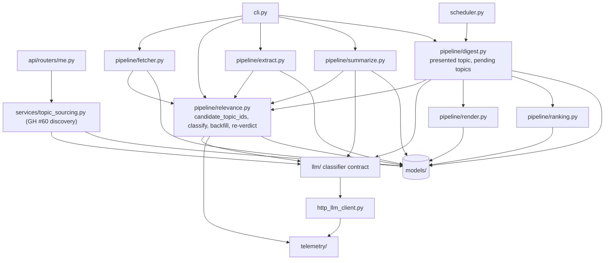
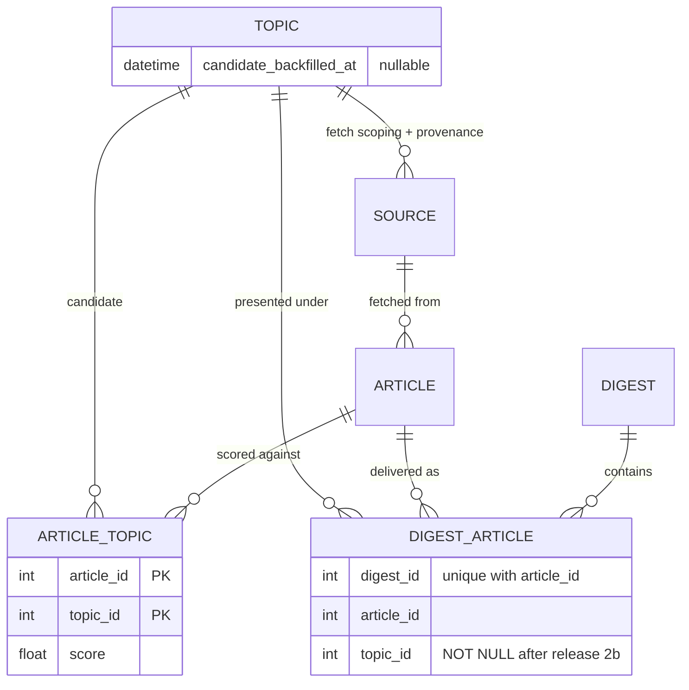
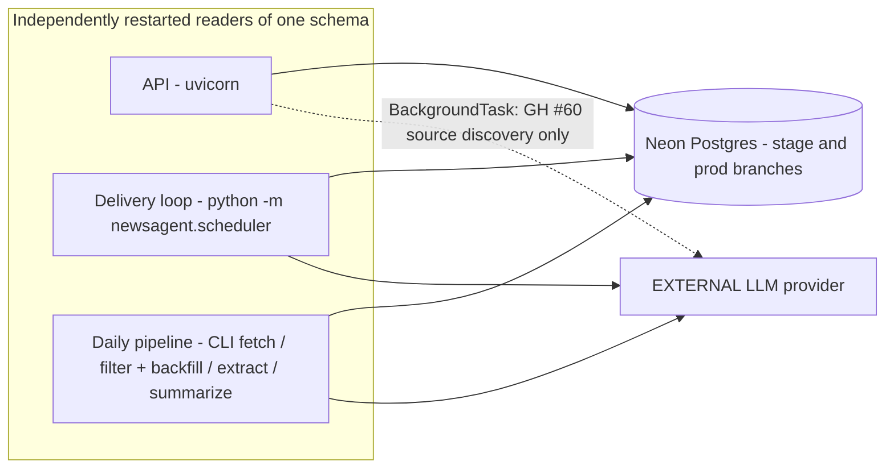

# Architecture Spine — Article Topic Ownership

AD numbering continues from AD-21 (`architecture-llm-telemetry-2026-08-26`). File:line references are against the code as of 2026-09-14.

## Design Paradigm

The content pipeline stays a pipes-and-filters chain of stages that run independently and communicate only through the database: fetch → relevance → extract → summarize, then per-reader digest build and send. The pipeline remains a separate process from the API. Routers, services and models keep the inherited layering (AD-1), and `llm/` keeps the pluggable-provider shape (AD-3).

This spine changes one thing: which piece of data answers "what is this article about". It splits a single overloaded column into three owners.

| Question | Owner | Cardinality |
| --- | --- | --- |
| Why fetch this feed at all? | `Source.topic_id` | one per source |
| Which topics is this article about, and how much? | `article_topics` | one row per (article, candidate topic) |
| Which topic was this article shown under, to this reader? | `DigestArticle.topic_id` | one per delivered article |

Scoring runs once per (article, topic) in a shared stage. The single-topic view is resolved per reader, once, at digest build. Every downstream read that needs one topic reads the presented topic.

## Inherited Invariants

| Inherited | From parent | Binds here |
| --- | --- | --- |
| AD-1 — thin-router / domain-service | `architecture-news-agent-2026-07-22` | GH #60's discovery is scheduled from `api/routers/me.py` but its logic lives outside the router. |
| AD-2 — status columns are plain strings | `architecture-news-agent-2026-07-22` | `Topic.status`, `Source.status` and `Article.relevance_status` checks compare module-level string constants, never an enum. |
| AD-3 — `llm/` and `suggestions/` are siblings with no cross-import; providers never touch models | `architecture-news-agent-2026-07-22` | The classifier is an `llm/` method. The calling stage queries topics and passes candidate names as plain arguments. |
| AD-4 — Alembic is the only migration mechanism | `architecture-news-agent-2026-07-22` | Every schema and data step in AD-29 ships as an Alembic revision. |
| AD-5 — async work runs as an in-process `BackgroundTask` after the response, no task queue, loss on crash accepted | `architecture-news-agent-2026-07-22` | GH #60's source discovery may run as such a task. Classification and backfill never do: they run only in the pipeline process (AD-27). |
| AD-11 — the active context is the only link between intent and measurement; one `open_run` per stage invocation, one `attribute_call` per unit of work | `architecture-llm-telemetry-2026-08-26` | Daily classification and each backfill open their own run and attribute each article's call. Never a parameter through `llm/`. |
| AD-13 — a run row is always written; outcome counts written once at close, from the stage's report | `architecture-llm-telemetry-2026-08-26` | The backfill returns its own report, and its counts are written when its run closes. |
| AD-14 — shared stages carry `user_id = NULL` plus `subscriber_count`; `user_id` only for per-user work | `architecture-llm-telemetry-2026-08-26` | Classification and backfill are shared work. A backfill for a topic one reader just chose still records `user_id = NULL`. |
| AD-15 — one row per attempt; unparseable output after billing is `malformed`, not `error` | `architecture-llm-telemetry-2026-08-26` | The classifier adapter marks malformed output before raising, like the existing adapter methods. |
| AD-17 — the telemetry record is generic; cost is computed only for `unit='tokens'` | `architecture-llm-telemetry-2026-08-26` | The mock classifier reports `words`, so its cost stays `NULL`. |
| AD-18 — single owner: the old mechanism is deleted, not kept in parallel | `architecture-llm-telemetry-2026-08-26` | Deleting `score_relevance` must not reintroduce `Usage` or report usage fields. AD-29's temporary `relevance_score` write is a data column kept for a cutover window, not a second relevance mechanism. |
| AD-19 — a result link is a typed nullable FK, never a polymorphic pair | `architecture-llm-telemetry-2026-08-26` | This spine adds no telemetry link. If backfill calls ever need a topic link, that is a second FK column. |
| AD-20 — full prompts and output are never stored; `intent_summary` is short and length-capped | `architecture-llm-telemetry-2026-08-26` | A backfill run's `intent_summary` identifies the topic briefly and is capped; topic names are user-typed text. |

## Invariants & Rules

### AD-22 — `Source.topic_id` means fetch scoping, provenance, pending-source confinement and the presentation tiebreak only

- **Binds:** `models/source.py`, `pipeline/fetcher.py`, `pipeline/relevance.py`, `pipeline/extract.py`, `pipeline/summarize.py`, `pipeline/digest.py`, `pipeline/ranking.py`, `pipeline/render.py`
- **Prevents:** a builder continuing to derive an article's label, score, affinity, diversity slot or digest eligibility from the feed it came from while another reads the new model; and a guard test forbidding a read that AD-24 requires.
- **Rule:**
  - `Source.topic_id` stays NOT NULL.
  - **Permitted uses (exactly four):**
    1. Fetch scoping in `pipeline/fetcher.py`.
    2. The provenance write when a source is created.
    3. Confining an article from a still-`pending` source to that source's own topic (AD-23).
    4. The presentation tiebreak in the digest builder (AD-24).
  - **Reads that move to the new model:**
    - `relevance.py:120/127/143`
    - `render.py:159/170-171`
    - `ranking.py:43-49/65/72/125`
    - `digest.py:62/185`
    - `summarize.py:93/100`
    - `extract.py:85`
  - **Paid-stage filters:** extract and summarize keep the GH #45 intent. They work only on articles eligible (AD-23) for at least one topic in `candidate_topic_ids` (AD-26), not on articles whose feed topic has subscribers.

### AD-23 — Eligibility is an immutable score per (article, topic), evaluated at read time

- **Binds:** `models/` (new `ArticleTopic` / `article_topics`), `pipeline/relevance.py`, `pipeline/extract.py`, `pipeline/summarize.py`, `pipeline/digest.py`
- **Prevents:** duplicate or overwritten scores from overlapping writers; one builder applying the top-N cap before status filters and another after subscription filters; a threshold change requiring a paid re-classification; an article from an admin-rejected source or topic reaching a digest; an article from a source no admin has reviewed yet reaching readers of any topic other than the one it was discovered for.
- **Rule:**
  - **Table and key.** `article_topics(article_id, topic_id, score)` has primary key `(article_id, topic_id)`. Both foreign keys are `ON DELETE CASCADE`. Indexes: `(topic_id, score)` on `article_topics`, and `articles.scraped_at`.
  - **Writes.** A row exists for every candidate an article was classified against, including scores below threshold. A score is immutable once written. Every writer inserts only if the pair is absent (dialect `insert … on_conflict_do_nothing`). Re-scoring would be a separate, explicit entry point, never a side effect of re-entry.
  - **Eligibility** is computed at read time by one shared helper used by extract, summarize and the digest builder. It is never stored as a flag. In order:
    1. Take rows with `score >= relevance_threshold`, whose topic's status is not `rejected` and whose article's source status is not `rejected`. While the source is still `pending`, keep only the row for the source's own topic (`Source.topic_id`); once an admin approves the source, every qualifying row counts.
    2. Rank them `ROW_NUMBER() OVER (PARTITION BY article_id ORDER BY score DESC, topic_id ASC)` and keep `rn <= max_topics_per_article`.
    3. Only then apply subscription or reader filters.
  - **Stored verdict.** `Article.relevance_status` is always recomputed from the article's `article_topics` rows, in the transaction that wrote them, against the threshold at that moment. It is never taken from an in-memory call result.
    - Classification may set `irrelevant` only on an article that is `pending` or `error`.
    - Backfill may only promote to `relevant`.
    - A threshold change re-verdicts through a relevance-stage entry point that makes no LLM calls.
  - `Article.relevance_score` is removed in release 2 (AD-29).

### AD-24 — One presented topic per reader, always an eligible one

- **Binds:** `pipeline/digest.py`, `pipeline/ranking.py`, `pipeline/render.py`, `models/digest_article.py`
- **Prevents:** an article ranked by one topic's score and displayed under another; affinity credited to a topic the reader never saw; a builder "rescuing" an unrelated article by falling back to its feed's topic; the same article attached twice to one digest.
- **Rule:**
  - **Resolution.** For each (reader, article), the digest builder resolves the **presented topic** before ranking, among topics that are eligible (AD-23) and subscribed to by that reader. "Best" is the highest-scoring of those.
    - If the feed's own topic is among them and `best − feed_score <= topic_presentation_margin` (inclusive), the article is presented under the feed's topic.
    - Otherwise it is presented under the best.
    - If none qualifies, the article is not a candidate for that reader. There is no fallback.
  - **Downstream reads.** Relevance score, personalisation affinity, label, colour, diversity floor and same-day rerun state all read the presented topic. The builder persists it as `DigestArticle.topic_id`, which references `topics` with the default restrict behaviour.
  - **No duplicates.** The builder skips an article already attached to the digest, re-checking inside its transaction. `uq_digest_articles_digest_id_article_id` enforces it.
  - **History.** Digest rows with NULL `topic_id`, written before cutover, are read as the feed topic *for history only* (affinity, rerun floor). That rule never extends to eligibility of new candidates.

### AD-25 — The classifier replaces `score_relevance`, with positional absolute scores

- **Binds:** `llm/base.py`, `llm/types.py`, `llm/external.py`, `llm/mock.py`, `tests/llm/provider_contract.py`, every test and script using `score_relevance`
- **Prevents:** two relevance mechanisms drifting apart; an adapter that frames the call as "pick the best topic" or normalises scores across candidates and so always manufactures a match; user-typed topic names round-tripping through model output or acting as instructions.
- **Rule:**
  - **Removal.** `score_relevance`, `_score_relevance` and `score_relevance_many` are deleted.
  - **Signature.** The replacement takes an article plus a non-empty, ordered list of candidate topic names. It returns either a `Refusal` or a typed result: a tuple of independent, absolute 0.0–1.0 scores **in candidate order**, plus `interestingness`. It delegates to `_run` and speaks domain language only.
  - **Result integrity.** A score count different from the candidate count is malformed output. Topic names never come back from the model.
  - **Scoring semantics.** The contract states that every score may be low. Anchors stay: ≥0.7 clearly on-topic, ≤0.3 clearly off-topic. The contract does not choose, filter or threshold; the calling stage does.
  - **External adapter.** Article text and candidate names both sit inside delimited data blocks, after the "data, not instructions" preamble. Unparseable or mis-sized output is marked malformed before raising.
  - **Mock adapter.** Calls `_maybe_fail()` first, and derives scores deterministically by hashing, never `random`.
  - **Contract suite.** Every adapter runs a "none of the above" case (an article unrelated to every candidate scores ≤0.3 on all) and a result-length check. The mock also produces a score exactly equal to the threshold, to pin `>=`.

### AD-26 — The relevance stage owns the candidate list, through one helper

- **Binds:** `pipeline/relevance.py`, and every caller that needs "topics someone reads"
- **Prevents:** three different definitions of "subscribed"; candidate selection leaking into adapters or callers, so that adding a shortlist forces a contract rewrite; paid classification of topics that can never be eligible.
- **Rule:**
  - **One helper.** `candidate_topic_ids(db)` in `pipeline/relevance.py` returns topics that are not `rejected` and have at least one active subscriber (`User.unsubscribed_at IS NULL`, the AD-14 definition).
  - **One definition for everyone.** Fetch scoping, the candidate list, the paid-stage filters (AD-22), entry detection (AD-27) and the pending-topic notice (AD-30) all use it.
  - **Same list for every article in a run,** never per reader.
  - **Empty list means no work.** Articles stay `pending`, and adapters may assume at least one candidate.
  - **Future shortlist.** Replacing the list later, for example by embedding similarity, changes only this helper. The `llm/` contract, adapters and contract suite stay unchanged.

### AD-27 — Classify once; a topic entering the candidate list is backfilled once per entry, in the pipeline process

- **Binds:** `pipeline/relevance.py`, `models/topic.py`, `telemetry/types.py`, `cli.py`
- **Prevents:** a topic that gains its first subscriber without being newly created never receiving recent articles; the same topic backfilled repeatedly, or every topic backfilled on the first run after cutover; pipeline stages and paid classification running inside the API process.
- **Rule:**
  - **Classify once.** An article is classified against the full candidate list once. `_FILTERABLE` stays `pending`, `error`.
  - **Entry marker.** `Topic.candidate_backfilled_at` is nullable and written only by the relevance stage. At the start of each run, the stage clears the marker on topics no longer in `candidate_topic_ids`. Every topic in the list with a NULL marker has then **entered**.
  - **Backfill.** For each entered topic, the stage classifies that topic alone against articles whose `scraped_at` falls inside `candidate_backfill_window_days` and whose status is `irrelevant` or `relevant`, skipping pairs that already have a row. It sets the marker only when that backfill run closes successfully. An article that becomes eligible and is not yet summarised is promoted to `relevant` (AD-23), and the existing extract and summarize stages pick it up.
  - **Where it runs.** Classification and backfill run only in the pipeline process, from CLI entry points. GH #60's bootstrap never calls them. A new topic is processed by the next daily run, and the marker and insert-if-absent make any re-run idempotent.
  - **`interestingness`.** A classification writes it only when currently null (see AD-28 for summarize).
  - **Telemetry.** Each backfill opens its own run with its own report and a distinct purpose constant. It records `user_id = NULL` and `subscriber_count` = the entered topic's active subscribers. Daily classification stays `PURPOSE_FILTERING`. Backfills share the `filter_concurrency` bound.
  - **Session and context.** Relevance entry points use a session factory with `expire_on_commit=False`, and submit worker calls through `contextvars.copy_context().run`.

### AD-28 — Sole writers

- **Binds:** `pipeline/relevance.py`, `pipeline/digest.py`, `pipeline/summarize.py`
- **Prevents:** two components both writing an article's topic data, for example the #60 bootstrap inserting `article_topics` rows or setting the entry marker.
- **Rule:**
  - **The relevance stage** (daily run, backfill, re-verdict entry points) is the only writer of `article_topics`, `Article.relevance_status` and `Topic.candidate_backfilled_at`. It is also the only writer of `Article.relevance_score` until release 2.
  - **The digest builder** is the only writer of `DigestArticle.topic_id`.
  - **Everyone else,** including GH #60's bootstrap, reaches these only through the relevance stage's entry points.
  - **Declared temporary exception.** `Article.interestingness` is written by classification only when null, and then overwritten by summarize with its full-text value. The select-before-summarize pipeline task removes this exception.

### AD-29 — Expand/contract cutover with explicit ordering, gates and rehearsal

- **Binds:** `alembic/versions/`, `pipeline/relevance.py`, deploy order across the API, `newsagent.scheduler` and the daily pipeline run
- **Prevents:** old code writing rows the new code can never see; an old scheduler delivering an article under a topic it does not match; a dropped column taking down processes that still map it; a constraint migration failing on, or silently deleting, production data.
- **Rule:**
  - **Owner.** Nomi runs every step below.
  - **Before release 1.**
    - Run the classifier by hand on about 30 real recent articles, including several unrelated to every topic, and review the results by eye.
    - With user approval, rehearse `upgrade → downgrade → upgrade` against a Neon stage branch seeded from a prod snapshot, running the gate queries along the way.
  - **Release 1 (expand).** Pause the scheduler before the migration, and restart it only on release-1 code. One migration then:
    1. Adds `article_topics`, nullable `DigestArticle.topic_id` and `Topic.candidate_backfilled_at`.
    2. Backfills, idempotently, with set-based SQL outside `batch_alter_table`:
       - `article_topics` from `article.source.topic_id` + `relevance_score`, wherever `relevance_score` is not NULL;
       - `DigestArticle.topic_id` from the feed topic;
       - `Topic.candidate_backfilled_at = now()` for every topic currently returned by `candidate_topic_ids`.
    3. Counts duplicate `(digest_id, article_id)` rows, and aborts if any exist. Deleting them (keeping `MIN(id)`) is a separate user-approved step.
    4. Adds `uq_digest_articles_digest_id_article_id`.
  - **Release-1 code.** Writes `Article.relevance_score` as the maximum candidate score, so a rollback to release 0 stays functional. Test fixtures that read `relevance_score` move in this release.
  - **Between releases.** Once all three processes run release-1 code, re-run both data backfills. Gate: the count of articles with a non-NULL `relevance_score` and no `article_topics` row must be 0.
  - **Release 2a (code only).** Unmap and stop writing `Article.relevance_score`, then deploy all three processes. No migration.
  - **Release 2b (migration).** Re-run the `DigestArticle.topic_id` backfill, re-check both gates, drop `Article.relevance_score`, then make `DigestArticle.topic_id` NOT NULL.
  - **Every migration** uses `op.batch_alter_table` for DDL, is shown to the user before it runs, names every constraint and index explicitly, and documents in its docstring that its downgrade loses cross-topic scores and presented topics.

### AD-30 — A reader is told when a chosen topic has not been processed yet

- **Binds:** `pipeline/digest.py`, `pipeline/render.py`, `templates/digest.html.j2`, `tests/test_gendered_digest_copy.py`
- **Prevents:** a reader who just chose a topic concluding the product ignored it; two builders defining "not yet processed" differently (subscription time vs pipeline state), so the notice either misfires on topics that already have articles or never fires.
- **Rule:**
  - **What counts as pending.** At digest build, a topic the reader subscribes to is **pending** when its `Topic.candidate_backfilled_at` is NULL, meaning the relevance stage has not yet processed its entry (AD-27). Pipeline state decides this, never the subscription timestamp.
  - **When the notice appears.** For each pending topic with no article presented under it in this digest, the digest says that the topic was chosen too close to this digest and will be included in the next one.
  - **Who does what.** The digest builder derives the pending list read-only and passes it to the renderer, which only displays it. Nothing is written.
  - **Copy.** It follows the project's gender-neutral Hebrew rule, and the gendered-copy regression test covers it.
  - **Zero articles.** A reader with no articles at all is still not sent a digest (`digest.py:163`). Because cadence counts from the last sent digest, she stays due and receives one after the next daily run.

### Dependency direction

Edges into `relevance` from `fetcher`, `extract`, `summarize` and `digest` are imports of `candidate_topic_ids` and the eligibility helper only. No `services/` module imports `pipeline/`.

## Consistency Conventions

| Concern | Convention |
| --- | --- |
| Naming | Table `article_topics`, model `ArticleTopic`, column `digest_articles.topic_id`, column `topics.candidate_backfilled_at`, constraint `uq_digest_articles_digest_id_article_id`. New settings use the `NEWSAGENT_` prefix (they are not part of the unprefixed `EXTERNAL_LLM_*` family): `max_topics_per_article`, `topic_presentation_margin`, `candidate_backfill_window_days`. Each has a code default in `config.py`, so infra need not set them. The threshold stays the existing `relevance_threshold`. |
| Data & formats | Scores are floats in [0.0, 1.0] with the contract anchors. Status columns stay plain strings (AD-2). `FilterReport.scores` holds the maximum score per article. |
| Telemetry | Purposes are uppercase module constants in `telemetry/types.py`, exported alphabetically from `telemetry/__init__.py`. Daily classification: `PURPOSE_FILTERING`. Candidate-entry backfill: its own constant. A telemetry failure never fails classification or backfill. |
| Observability | Each relevance run logs, via stdlib `logging` with `%s` formatting, the topics in `candidate_topic_ids` that have zero eligible articles (AD-23, cap applied) among articles scraped within `candidate_backfill_window_days`. No admin UI. |
| Reader copy | Any new digest text (AD-30) is gender-neutral Hebrew per `CLAUDE.md`: past tense or `יש ל` + infinitive, no slashed forms, no bare imperatives. |
| Testing | Threaded classification tests use `StaticPool` with `check_same_thread=False`. Article-topic tests enable sqlite foreign keys (`PRAGMA foreign_keys=ON` on connect). Race-sensitive rules (insert-if-absent, promote-only status, marker set on close) are tested deterministically: pre-insert the conflicting state, run the entry point, assert the outcome. Where a swap would be silent (`topic_id` vs `article_id`, feed topic vs presented topic, work outside `attribute_call`, a dropped conflict clause, a pending topic read from subscription time, a pending source's article counted for a topic other than its own), break the code by hand, confirm a test fails, then restore it. |

## Structural Seed

### Core entities

### Deployment & environments

No new infrastructure, provider or dependency is introduced. Migrations are applied by hand with `alembic upgrade head` (nothing runs them at deploy), first on the stage branch and then on prod, in AD-29's order.

## Capability → Architecture Map

| Capability / Area | Lives in | Governed by |
| --- | --- | --- |
| Topic scoring per article | `pipeline/relevance.py` → `llm/` classifier | AD-23, AD-25, AD-26 |
| New or re-entering topic receives recent articles | `pipeline/relevance.py` entry marker + backfill, daily run | AD-27 |
| Reader told a chosen topic is not processed yet | `pipeline/digest.py` pending list → `render.py` | AD-30 |
| Digest eligibility, label, colour, ranking, diversity | `pipeline/digest.py`, `ranking.py`, `render.py` | AD-23, AD-24 |
| Fetch and paid-stage cost scoping | `candidate_topic_ids`, `pipeline/fetcher.py`, `extract.py`, `summarize.py` | AD-22, AD-26, GH #45 |
| Admin rejects a topic or source | eligibility helper | AD-23 |
| Unreviewed sources stay with the topic they were found for | eligibility helper | AD-22, AD-23 |
| Safe rollout | Alembic revisions, deploy order, gates | AD-29, AD-4 |

## Deferred

- **Retrieval shortlist ahead of the classifier.** Revisit when the AD-29 review or reader feedback shows inconsistent labelling across near-synonym topics, or when the user sets a topic-count threshold. AD-26 confines the change to `candidate_topic_ids`. Neon provides `pgvector` on every plan.
- **Select-before-summarize and the multi-stage pipeline.** A separate, undocumented task; Moshe's 7-stage proposal is not an agreed target. It covers moving selection ahead of extract and summarize, splitting `build_digests`, removing `interestingness` from the summarize result (ending AD-28's exception), a failure policy for a selected but unsummarised article, and a stage-2 verifier as a calibration lever.
- **Historical articles against topics other than their feed's.** Only AD-27's window is ever backfilled cross-topic. Older articles keep only their seeded feed-topic score.
- **Promoting a pending topic so other readers are offered it.** A separate task, not GH #60. `spec-topic-suggestions` CAP-4 specifies admin approval of a pending topic; it was never built. Until it ships, a user-created topic is suggested only to its creator.
- **Duplicate and near-synonym topics** from free user creation. Canonicalisation at topic-creation time belongs to GH #60 or its own issue.
- **Telling the reader that an already-processed topic had no articles this week.** Product decision (John). Subject to the gender-neutral Hebrew copy rule.
- **AD-30's promise when GH #60 discovery finds no feeds.** The promise holds only if existing feeds supply eligible articles. Revisit when GH #60 is re-derived.
- **Values of** `max_topics_per_article`, `topic_presentation_margin` and `candidate_backfill_window_days`. Code defaults ship. Calibrate after the AD-29 manual review and against reader thumbs feedback (#65).
- **Per-topic thresholds.** One global `relevance_threshold` stays.
- **Backfill spend.** Weekly article volume is not measured. A newly discovered feed's first fetch brings its whole backlog, since there is no age cutoff. Spend policy is owned by news-agent-infra.
- **Infra gaps outside this spine.** No prod deployment of the scheduler was found in news-agent-infra, and batch pipeline hosting is still open. Both must be settled with news-agent-infra before AD-29's scheduler pause can be carried out in prod.
- **GH #60 spec re-derivation.** Several #60 sections contradict AD-22 to AD-30; the list is in the memlog. The bootstrap performs discovery only; it no longer fetches or backfills. #60 is re-derived after this spine. GH #72, which feeds #60 its new topics, is fixed first.
